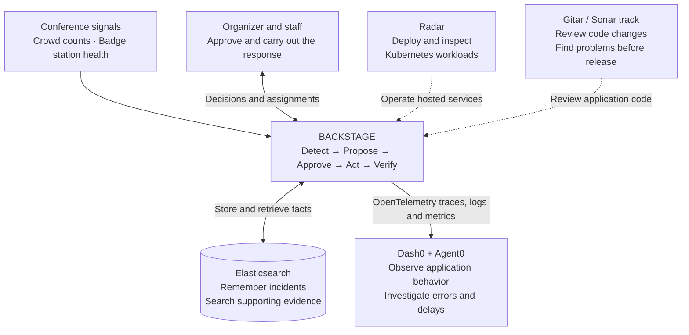

# Backstage

Backstage helps conference organizers detect problems, coordinate a human-approved response, and verify that recovery actually happened. One verified scenario is a Room B overflow replay that moves through approval, staff acceptance, and 60 seconds of qualifying recovery evidence.

The repository contains the application services, v1 API contract and shared fixtures. The fixture server described below lets contributors try static HTTP examples; see the [incident API](services/incident-api/README.md) and [web app](apps/web/README.md) guides for the running application.

## How the tools fit together

Each tool supports a different part of the same incident journey.



Solid arrows show application and data flow. Dashed arrows show development and infrastructure support; they do not imply that Gitar deploys the app or Radar automatically approves incident actions.

| Tool | Simple explanation | How Backstage uses it |
| --- | --- | --- |
| **Gitar — Sonar track** | **Checks the code we build.** | Reviews pull requests against project rules, including permissions and incident lifecycle behavior. It caught a voice-permission issue fixed in [PR #18](https://github.com/lukeeskinner/Backstage/pull/18), helping prevent defects from reaching organizers. See the [project review guidance](.gitar/review/backstage.md). |
| **Dash0 + Agent0** | **Shows how the software is behaving.** | Receives browser/API traces, logs and metrics through OpenTelemetry. The measured dashboard shows request latency, Elasticsearch latency and evidence-indexing lag. Agent0 helped investigate error metrics; a local regression then confirmed an empty-checkpoint classification bug that was fixed. See the [observability guide](observability/README.md) and [recorded QA evidence](docs/demo/incident-evidence-qa.md). |
| **Radar** | **Helps operate the computers running Backstage.** | The team used Radar MCP to deploy and inspect Kubernetes workloads and rehearse a badge-station outage. After organizer approval and staff acceptance, Station B completed the affected badge jobs. See the [team's cluster rehearsal and deployment record](docs/radar/handoff-log.md). |
| **Elasticsearch** | **Remembers what happened and finds the evidence.** | Stores the authoritative incident checkpoint and a separate searchable collection of committed events. Authorized users can search by text, room, event type and time, then inspect the exact event. This preserves incident history across restarts and makes decisions explainable. See the [storage and search setup](data/elasticsearch/README.md). |

## Example: Room B becomes crowded

1. Backstage receives repeated crowd counts and proposes a response.
2. An organizer approves; the assigned staff member acknowledges the assignment.
3. **Elasticsearch** preserves the decisions and the recorded recovery observations.
4. Backstage waits for **60 seconds of qualifying recovery evidence** before resolving the incident.
5. **Dash0** shows the requests, storage operations and correlated telemetry behind that journey.
6. **Radar** supports operating the hosted services; **Gitar** reviews changes to their code before release.

The same approval-and-verification pattern applies to badge incidents, with completed badge-job/PDF references as recovery evidence instead of a crowd-count window.

## Integration status and boundaries

- **Elasticsearch:** the implemented evidence search uses keywords and filters. Vector search and RAG are not part of this flow. Durable incident storage is separate from the badge simulator's queue, which remains in memory under its current configuration.
- **Radar:** the team recorded real cluster operations and a badge failover rehearsal. The badge application's automatic diagnosis adapter remains configured as `RADAR_MODE=mock`; see the [adapter modes](services/badge-simulator/radar/README.md).
- **Dash0:** cloud ingestion and correlation were verified from the isolated local rehearsal. The November 9 hosted-release handoff records the cluster collector, server-only credentials and evidence alias configured, with hosted browser/provider readback still pending at that checkpoint. Follow the [latest web deployment handoff](docs/demo/handoff-log.md) for subsequent verification.
- **Gitar:** pull-request review and checks are verified. Automatic fix application and automatic merging are not established by the recorded evidence.

## Local fixture setup

Use Python 3.12 or 3.13 and Make.

```sh
python3 -m venv .venv
.venv/bin/python -m pip install -r requirements-check.txt
make check
make smoke SCENARIO=overflow
make dev SCENARIO=overflow
```

The fixture server listens on `127.0.0.1:8000`. Try `curl http://127.0.0.1:8000/api/v1/incidents` or `curl http://127.0.0.1:8000/api/v1/incidents/inc-overflow-room-b/events`. The `stage_av` and `badge_stall` scenarios are also available. The fixture server serves static responses for GET routes. Use the request and error examples to build stateful mocks and service implementations.

## Team

- [Latest team updates and how to hand off each push](docs/handoffs/README.md)
- [Full team handoff](BACKSTAGE-team-agent-handoff.md)
- [Kunj · React, accessibility, and Dash0](docs/handoffs/kunj.md)
- [Ali · Badge simulator, Radar, and Kubernetes](docs/handoffs/ali.md)
- [Ownership and contribution workflow](CONTRIBUTING.md)
- [OpenAPI contract and schemas](contracts/README.md)
- [Fixture index](fixtures/shared/README.md)
