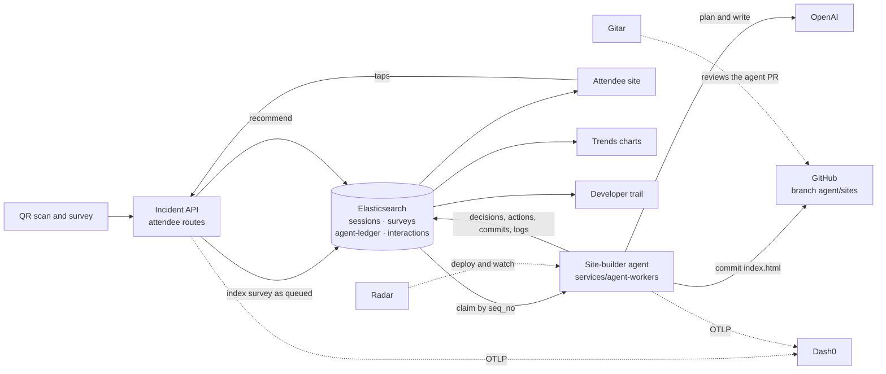

# Pivot kickoff: a coding agent builds every attendee their own conference site

Written 2026-11-09 23:08 UTC from Anurup's lane as the shared starting point for a one-hour build. Nothing on this page is built yet unless a row says "verified". **T0 is the moment you finish reading your lane.**

An attendee scans the QR code and answers five questions. A coding agent then writes a site for that one person and commits it to this repository. Everything the agent read, decided and did becomes a document in Elasticsearch, a span in Dash0 and a workload you can watch in Radar. The attendee sees the site. Organizers and developers see how it was made.

The incident board, history and evidence search stay exactly as they are. This adds a second surface beside them.

## The flow

Solid arrows are application data. Dashed arrows are telemetry, operations and review.

## Lanes

Every lane stays inside paths it already owns in the [owner map](../../.github/owners.json), so the `changed-paths` check passes without waiting on an ownership change.

| Person | Lane | Branch prefix | Paths | Guide | Push log |
| --- | --- | --- | --- | --- | --- |
| **Anurup** | Elasticsearch data plane, attendee and trail APIs, developer trail screen | `anurup/` | `data/elasticsearch/`, `services/incident-api/`, `contracts/`, `deploy/incident/`, `deploy/dash0/`, `apps/web/src/api/`, `apps/web/src/diagnostics/` | [anurup.md](lanes/anurup.md) | `docs/handoffs/anurup-log.md` |
| **Luke** | Site-builder agent, GitHub commits, repo gates, merges | `luke/` | `services/agent-workers/`, `generated/`, `.github/`, `.gitar/`, root | [luke.md](lanes/luke.md) | `docs/handoffs/luke-log.md` |
| **Kunj** | Survey, attendee site, trends charts | `kunj/` | `apps/web/`, `deploy/web/`, `docs/demo/` | [kunj.md](lanes/kunj.md) | `docs/demo/handoff-log.md` |
| **Ahmed** | Cluster runtime through Radar, simulated attendees, evidence | `ali/` | `deploy/platform/`, `deploy/badge/`, `services/badge-simulator/`, `docs/radar/` | [ahmed.md](lanes/ahmed.md) | `docs/radar/handoff-log.md` |

Ahmed's branches keep the `ali/` prefix because that is the lane key the check reads. The usual rules still hold: read the [team updates](../../docs/handoffs/README.md) first, and every push carries a log entry.

## The clock

| Clock | Gate | What must be true |
| --- | --- | --- |
| T+0 to T+5 | Start | Branch cut from `main`. Anurup has tried the index bootstrap. Luke has the `agent/sites` branch and a GitHub token. Ahmed knows the CPU headroom. Kunj has routes on mock data. |
| T+15 | 1 · Skeleton | The public host answers `POST /api/v1/attendee/surveys` and `GET /api/v1/attendee/{id}` with lexical recommendations. The agent finishes one template build in dry-run against the real index. |
| T+30 | 2 · Joined up | One real survey goes queued, building, ready with a real commit on `agent/sites`, and the site renders at phone width. Trends and trail return real aggregations. |
| T+40 | 3 · On the cluster | API, agent and web run in `team-backstage` at pinned SHAs. The QR works from a phone on cellular. The simulator Job is feeding traffic. |
| T+50 | 4 · Evidence | One Dash0 trace from tap to commit is saved. The Radar view of the agent is saved. Trail search goes from a decision to its commit to its trace. |
| T+55 | Freeze | No new features. PRs merged, logs appended, pins recorded. |

Deploy early. The API rolls in about a minute, so it rolls twice (T+15 and T+35). Web re-installs the vision dependencies on every rollout and takes several minutes, so it gets at most two rollouts.

## Contract v1

Field names and enums are frozen at T0. Complete example payloads are in [examples.v1.json](examples.v1.json); mock against that file until the live API answers. Additive changes only, announced to the consumers named below.

### Indices

`P` is `ELASTICSEARCH_INDEX_PREFIX` (`backstage-demo` on the cluster). Applications use the alias; the write index is the alias plus `-v1`, as with the evidence index.

| Alias | One document is | `_id` | Written by | Read by |
| --- | --- | --- | --- | --- |
| `P-sessions` | one session in the demo catalog | `session_id` | bootstrap seed | API, agent |
| `P-surveys` | one attendee: answers, recommendations, site build state | `attendee_id` | API creates; agent updates `site.*` | API, agent |
| `P-agent-ledger` | one thing the agent read, decided or did | `{run_id}:{seq}` zero-padded to 4 | agent, create-only | API |
| `P-interactions` | one tap on a recommendation | generated | API | API |

Mappings use `dynamic: false`: an unknown field is kept in `_source` and ignored by search, so a stray field never rejects a write during the demo. Definitions land in `data/elasticsearch/pivot-*.json` by T+5.

### Values

| Field | Allowed |
| --- | --- |
| `attendee_id` | `att_` plus 12 characters of `[a-z2-7]`, generated by the API. It is the only credential an attendee holds. |
| `run_id` | `run_` plus 12 characters of `[a-z2-7]`, generated by the agent per build |
| `answers.role` | `attendee`, `speaker`, `staff`, `organizer` |
| `answers.interests` | one to three of `observability`, `platform-engineering`, `ai-agents`, `security`, `networking`, `storage-data`, `gitops-delivery`, `finops-sustainability`, `wasm-edge`, `community-careers` |
| `answers.level` | `new`, `practitioner`, `expert` |
| `answers.vibe` | `calm`, `bold`, `playful` |
| `answers.accessibility` | any of `large_text`, `reduced_motion`, `high_contrast` |
| `answers.goal` | optional free text, at most 140 characters |
| `source` | `qr`, `simulator` |
| `site.status` | `queued`, `building`, `ready`, `failed` |
| ledger `kind` | `decision`, `action`, `commit`, `log`, `error` |
| ledger `step` | `claim`, `retrieve`, `plan`, `write`, `validate`, `commit`, `publish` |
| ledger `outcome` | `ok`, `fallback`, `retry`, `rejected`, `error` |
| ledger `tool` | `elasticsearch`, `openai`, `template`, `validator`, `github` |
| ledger `decision.name` | `theme`, `layout`, `tone`, `featured` |
| `decision.value` for charts | theme: `calm-paper`, `bold-contrast`, `playful-pop`, `high-contrast`. Layout: `schedule-first`, `topic-clusters`, `single-focus`. Tone: `direct`, `warm`, `energetic`. Colors, copy and markup stay free. |
| `site.builder`, `site.commit_mode` | `template` or `openai`; `dry-run` or `github` |
| recommendation reason `code` | `interest`, `goal`, `level`, `trending`, `semantic` |
| interaction `action` | `open`, `save`, `dismiss` |

### HTTP

All routes are served by the incident API under `/api/v1` and reach browsers through the existing nginx proxy. Owner: Anurup.

| Route | Auth | Purpose |
| --- | --- | --- |
| `POST /attendee/surveys` | none, capped | Store the survey, compute recommendations, queue the build. Returns `201` with `attendee_id`. |
| `GET /attendee/{attendee_id}` | none; the id is the capability | Answers without `goal`, recommendations with session details, `site`, and `progress[]`. Poll every 2 s. |
| `POST /attendee/{attendee_id}/interactions` | none | Record one tap. Returns `202`. |
| `GET /pivot/trends` | organizer bearer (tier 3) | Chart data. Query: `window`, `interval`, `interest`, `source`. |
| `GET /pivot/trail/search` | organizer bearer | Search the ledger. Query: `q`, `kind`, `step`, `attendee_id`, `run_id`, `from`, `to`, `limit`. |
| `GET /pivot/trail/runs/{run_id}` | organizer bearer | One build's events in order. |

Errors keep the existing shape: `{"error": {"code", "message"}}`.

### API to agent: Elasticsearch is the queue

There is no HTTP call between the API and the agent.

1. The agent polls `P-surveys` every 2 s for `site.status: queued`, oldest first, size 1, with `seq_no_primary_term: true`.
2. It claims the document with `if_seq_no` and `if_primary_term`, setting `site.status` to `building`, a new `site.run_id`, and `site.attempt` plus one. A 409 means another worker won; move on.
3. It writes ledger documents with `op_type=create` and never updates one.
4. It finishes by writing `site.status`, `site.builder`, `site.commit_mode`, `site.html`, `site.html_sha256`, `site.spec`, `site.commit_sha`, `site.commit_url` and `site.updated_at`. A dry-run build leaves the two commit fields null.
5. The API may re-queue a survey stuck in `building` for more than 90 s once, then marks it `failed`.

### One trace from tap to commit

The API stores the W3C `traceparent` of the submit span on the survey document. The agent starts `agent.run` as a child of it. Every ledger document carries `trace_id` and `span_id`. Model calls use the GenAI span attributes (`gen_ai.request.model`, `gen_ai.usage.input_tokens`, `gen_ai.usage.output_tokens`).

### The generated page

What Luke's agent writes and Kunj's page renders:

- One complete HTML document with exactly one literal `<head>`, inline `<style>` only, system fonts, at most 60 KB.
- No `<script>`, no `on*=` attributes, no `javascript:` or external URLs, no `@import`, and none of `iframe`, `object`, `embed`, `form`, `link`, `base` or `meta http-equiv`. Inline SVG is fine.
- Each recommended session is an element with `data-session-id="sess-NNN"` that contains the session title as text. Optional buttons inside it carry `data-action="save"` or `data-action="dismiss"`. A tap elsewhere on the card means `open`.
- It honors `prefers-reduced-motion` and the attendee's accessibility choices.
- Committed as `generated/sites/<attendee_id>/index.html` on branch `agent/sites`. The same bytes go to `site.html`, with their SHA-256 in `site.html_sha256`.

### Settings

| Service | New settings |
| --- | --- |
| Incident API | `PIVOT_ENABLED`, `PIVOT_MAX_BUILDS_PER_HOUR` (default 300), `PIVOT_SEMANTIC` (`auto` or `off`) |
| Agent | `ELASTICSEARCH_URL`, `ELASTICSEARCH_API_KEY`, `ELASTICSEARCH_INDEX_PREFIX`, `OPENAI_API_KEY`, `AGENT_OPENAI_MODEL`, `AGENT_BUILDER` (`template` or `openai`), `AGENT_COMMIT_MODE` (`dry-run` or `github`), `GITHUB_TOKEN`, `GITHUB_REPO`, `AGENT_BRANCH` (`agent/sites`), `AGENT_SIM_COMMIT_EVERY` (default 10), the standard `OTEL_*` |

## Handoffs

Luke, Kunj and Ahmed can post these on the [agent board](../../docs/demo/agent-board.md). The board does not accept an `anurup-` sender yet, so Anurup tells people directly and records it in his log.

| When | From → to | What changes hands |
| --- | --- | --- |
| T+5 | Luke → Ahmed | The agent's GitHub token, typed into Radar's Secret editor. Never chat, Git or the board. |
| T+5 | Anurup → all | The four aliases exist and the mappings are pushed. If the runtime key cannot create indices, Anurup → Luke: create them with the admin CLI. |
| T+10 | Anurup → Kunj | Typed client `apps/web/src/api/pivot.ts` |
| T+10 | Kunj → Anurup | Route names and the one-line mount for `TrailConsole` |
| T+15 | Anurup → Ahmed | Skeleton API SHA. Ahmed rolls `incident-api`; the public host becomes the shared API for everyone. |
| T+15 | Luke → Anurup | Ledger documents flowing from dry-run builds |
| T+20 | Ahmed → Anurup, Kunj | Simulator runnable; first 50 simulated attendees sent |
| T+25 | Luke → Ahmed | Agent SHA and its settings list |
| T+30 | Luke → Kunj | First real `site.html` and commit URL |
| T+35 | Anurup → Ahmed | Final API SHA with `PIVOT_ENABLED=true` |
| T+35 | Kunj → Ahmed | Web SHA, or Kunj rolls web himself as before after telling Ahmed |
| T+45 | Ahmed → all | Three pins live, simulator Job running, Radar evidence recorded |

## Guardrails

These are not negotiable inside the hour.

1. **No identities.** The survey collects no name, email or device id. A site lives at an unguessable link.
2. **`goal` never reaches the model that writes code.** The free text is used for Elasticsearch retrieval only. It is never put in a code-writing prompt, never committed and never returned by a public route. This repository is public and a commit is permanent. It also closes the prompt-injection path: the model only sees our enums and our catalog.
3. **The agent has one place to write.** Only `generated/sites/<attendee_id>/index.html` on `agent/sites`, after `attendee_id` matches `^att_[a-z2-7]{12}$`. Never `main`. `agent/sites` reaches `main` only through a pull request that a person and Gitar review.
4. **Validate twice.** The agent validates the page before committing; the web page renders it in a sandboxed frame with a restrictive content policy. A rejected page falls back to the template builder and is logged as `rejected`.
5. **Caps.** One worker, at most 300 builds an hour, capped output tokens, a 20 s model timeout with template fallback. Simulated attendees use the template builder and dry-run commits except one in ten, which keeps us under GitHub's limits on content-creating requests.
6. **Secrets.** The OpenAI key and GitHub token exist only in Kubernetes Secrets, entered through Radar's Secret editor. The ledger ingest pipeline masks key-shaped strings as a second line of defense.
7. **Simulated data is labeled.** Simulator traffic carries `source: simulator`, trends report how much of the window is simulated, and the charts say so on screen.
8. **The incident product keeps working.** No change to incident routes, the checkpoint index or the single-writer rule. The pivot routes mount behind `PIVOT_ENABLED` and a pivot failure must not stop the API from starting.

## What each sponsor tool does here

| Tool | Role in the pivot | What a judge can open | Status |
| --- | --- | --- | --- |
| **Elasticsearch** | System of record and the queue. Hybrid recommendations, aggregations for trends, full-text search over the agent's trail, optimistic-concurrency claims. | The trends and trail screens, four index definitions, two ingest pipelines | To build. The checkpoint with optimistic concurrency and lexical evidence search are verified today. |
| **Dash0** | One trace from the phone tap to the Git commit across browser, API and agent, with model calls as GenAI spans. | A saved trace and a pipeline dashboard | To build. Collector, API and browser export are verified today. |
| **Radar** | Deploys and shows the agent, the API rollouts and the simulator Job, with live logs and events during the demo. | Radar views recorded in `docs/radar/handoff-log.md` | To build. Radar-operated deployments are verified today; badge diagnosis stays `mock`. |
| **Gitar** | Reviews the agent's code under a rule written for it, with an owner-map grant limited to `generated/sites/`. | The `agent/sites` pull request with Gitar's review | To build. Gitar pull-request review is verified today. |

## Demo in three minutes

1. The projector shows the QR code and a live count. A judge scans it.
2. Five questions on the phone, then submit.
3. "Building your site" lists the agent's steps as they happen: found six sessions, chose a layout, wrote the page, saved it as a commit.
4. Their site appears. They tap a session.
5. Organizer trends: that tap moved a bar. Interests over time, what the agent decided, how long builds take. Click a topic to filter everything.
6. Developer trail: search "why schedule-first", read the highlighted rationale, open the run, open the commit on GitHub, open the trace in Dash0 with the model call and its token counts.
7. Radar: the agent's pod, its live log and its events.
8. Close: every site is a commit, every decision is a document, every build is a trace.

## Risks and fallbacks

| Risk | Signal | Fallback | Owner |
| --- | --- | --- | --- |
| The runtime Elasticsearch key cannot create indices | 403 at T+5 | Luke creates the four indices with the admin CLI | Luke |
| No inference endpoint for semantic search | Probe at T+5 | Lexical plus trending boost. Say so in the demo. | Anurup |
| OpenAI is slow or down | Over 20 s or a 5xx | Template builder, logged as `fallback` | Luke |
| GitHub rejects writes | 403 or 429 | `AGENT_COMMIT_MODE=dry-run` keeps sites flowing; the ledger records it | Luke |
| The CPU quota rejects the agent Pod | Quota event in Radar | Scale the two badge stations to zero and record it | Ahmed |
| Web rollout runs long | Init over six minutes | Keep the last web release and demo the new screens from a laptop against the public API | Kunj |
| Too few real scans | Flat charts | Simulator Job, labeled on screen | Ahmed |

## Decisions made to save time

Tell the lane owner if you disagree; otherwise these stand.

1. The new routes live in the existing incident API because it already has the Elasticsearch client, telemetry and a cluster deployment.
2. The agent is Python in `services/agent-workers/` and deploys the way the incident API does.
3. One file per site per commit. The commit message carries the decisions, run id and trace id, so `git log` reads as a decision history.
4. Recommendations ship lexical first. Semantic search is added only if the T+5 probe finds a usable inference endpoint.
5. Charts are hand-drawn SVG. No new dependency goes into the in-cluster web build.
6. The session catalog is synthetic, marked `synthetic: true`, with rooms from the published venue list and no real speaker names.
7. The trail shows a trace id with a copy button. A Dash0 link returns only on that developer screen, only through the existing server-side `DASH0_TRACE_URL_TEMPLATE` check, and only if Luke agrees, since he removed provider links from the UI in `690fc6a`.

## Stretch, only after gate 3

- Rebuild from taps: saves and dismissals re-queue the survey and the agent commits a second version.
- Incident-triggered rebuild: when an overflow is approved for a room, re-queue the attendees whose picks are in that room and add a notice.
- Collector fan-out to Elasticsearch, so spans and logs are searchable beside the ledger.
- One Kubernetes Job per real attendee build, so each scan shows up in Radar.
